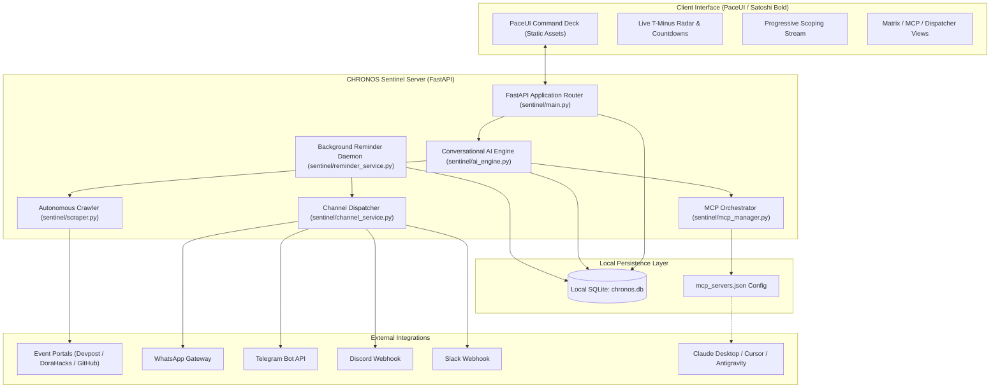
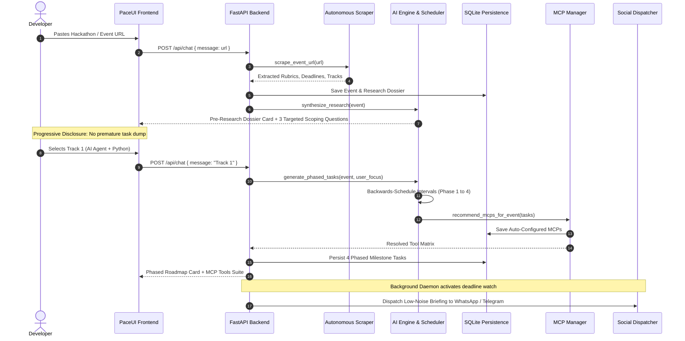

# CHRONOS // Autonomous Event Deadline Sentinel & MCP Orchestrator

```
   ██████╗██╗  ██╗██████╗  ██████╗ ███╗   ██╗ ██████╗ ███████╗
  ██╔════╝██║  ██║██╔══██╗██╔═══██╗████╗  ██║██╔═══██╗██╔════╝
  ██║     ███████║██████╔╝██║   ██║██╔██╗ ██║██║   ██║███████╗
  ██║     ██╔══██║██╔══██╗██║   ██║██║╚██╗██║██║   ██║╚════██║
  ╚██████╗██║  ██║██║  ██║╚██████╔╝██║ ╚████║╚██████╔╝███████║
   ╚═════╝╚═╝  ╚═╝╚═╝  ╚═╝ ╚═════╝ ╚═╝  ╚═══╝ ╚═════╝ ╚══════╝
      AUTONOMOUS DEADLINE SENTINEL & MCP ORCHESTRATION ENGINE
```

[](https://python.org)
[](https://fastapi.tiangolo.com)
[](https://sqlite.org)
[](https://modelcontextprotocol.io)
[](https://paceui.com)
[](LICENSE)
[-09090b?style=for-the-badge)](tests/test_chronos.py)

---

## Executive Overview

**CHRONOS** is a locally hosted, privacy-first autonomous AI companion engineered to solve the perennial developer dilemma: **missing critical deadlines, suffering hackathon panic, losing track of evaluation rubrics, and drowning in noisy notifications.**

When you enter an event or hackathon portal link (Devpost, DoraHacks, Taikai, GitHub repositories), CHRONOS automatically navigates and scrapes the material, extracts submission criteria and evaluation rubrics, conducts targeted conversational scoping without dumping overwhelming walls of text, decomposes tasks backwards from the deadline across four structured milestone phases, auto-resolves and provisions required Model Context Protocol (MCP) server configurations, and dispatches rate-limited executive briefings directly to your browser and external communication channels (**WhatsApp, Telegram, Discord, and Slack**).

Built on an editorial monochrome design language powered by **PaceUI** and **shadcn/ui**, the interface enforces a strict **Satoshi Bold** typographic hierarchy, a **minimum 14px Word-document font size**, and **zero emojis**, delivering an elite, quiet command deck for high-velocity builders.

---

## Key System Capabilities

| Capability | Module | Description |
| :--- | :--- | :--- |
| **Autonomous Link Ingestion** | [`sentinel/scraper.py`](sentinel/scraper.py) | Headless HTML & Markdown crawler that extracts target deadlines, evaluation criteria, prize tracks, and tech constraints. |
| **Progressive Scoping Agent** | [`sentinel/ai_engine.py`](sentinel/ai_engine.py) | Progressive disclosure chatbot that queries user priority tracks and architecture mode before decomposing tasks. |
| **Backwards Milestone Scheduler** | [`sentinel/ai_engine.py`](sentinel/ai_engine.py) | Backwards-calculates milestone intervals (Setup 15%, Core 50%, UI/Polish 80%, Submission Buffer 95%). |
| **Dynamic MCP Tool Resolver** | [`sentinel/mcp_manager.py`](sentinel/mcp_manager.py) | Analyzes task requirements and auto-configures GitHub, Firecrawl, DevTools, SQLite, Filesystem, and TigerGraph MCPs into `mcp_servers.json`. |
| **Multi-Channel Social Dispatcher** | [`sentinel/channel_service.py`](sentinel/channel_service.py) | Connectors for WhatsApp, Telegram, Discord, and Slack with integrated test ping simulation. |
| **Non-Nosy Sentinel Daemon** | [`sentinel/reminder_service.py`](sentinel/reminder_service.py) | Asynchronous background worker monitoring deadlines with intelligent cooldown limits (maximum 1 notification per hour). |
| **PaceUI Monochrome Command Deck** | [`sentinel/static/`](sentinel/static/) | 4-view workspace (Chat Sentinel, Timeline Matrix, MCP Orchestrator, Social Dispatcher) with live countdown radar. |

---

## System Architecture

### 1. High-Level Architectural Topology



### 2. Request Lifecycle & Progressive Scoping Pipeline



---

## Detailed Tech Stack

- **Backend Runtime**: Python 3.10+ (Fully compatible with Python 3.11, 3.12, 3.14)
- **Web Framework**: [FastAPI](https://fastapi.tiangolo.com) + [Uvicorn](https://www.uvicorn.org) high-performance ASGI server
- **Persistence**: Embedded [SQLite 3](https://sqlite.org) (`chronos.db`) with zero external database dependencies
- **Scraping & Ingestion**: [BeautifulSoup4](https://www.crummy.com/software/BeautifulSoup/) + [Requests](https://requests.readthedocs.io/) with custom heuristics for dates, tracks, and rubrics
- **Model Context Protocol (MCP)**: Native JSON-RPC schema generation matching official Anthropic MCP specification
- **Frontend Architecture**: Modern Vanilla ES6+ SPA adhering to [PaceUI](https://paceui.com) and [shadcn/ui](https://ui.shadcn.com) design guidelines
- **CSS Engine**: [Tailwind CSS CDN](https://tailwindcss.com) configured with semantic grayscale tokens
- **Typography**: [Satoshi](https://www.fontshare.com/fonts/satoshi) (Weights 700, 800, 900) paired with [Plus Jakarta Sans](https://fonts.google.com/specimen/Plus+Jakarta+Sans) and [JetBrains Mono](https://fonts.google.com/specimen/JetBrains+Mono)
- **External Channels**: Direct REST Webhooks & Bot APIs for WhatsApp, Telegram, Discord, and Slack
- **Automated Testing**: [Pytest](https://pytest.org) + `Starlette TestClient`

---

## Directory Organization

```
CHRONOS/
├── run_sentinel.py                 # Primary entrypoint launcher & browser auto-opener
├── mcp_servers.json                # Exported unified Model Context Protocol configuration
├── chronos.db                      # Local SQLite relational database (auto-generated)
├── requirements.txt                # Production Python dependencies
├── README.md                       # Comprehensive system documentation
├── .gitignore                      # Git exclusion rules (DB, pycache, env)
├── sentinel/                       # Core application package
│   ├── __init__.py                 # Package initializer
│   ├── main.py                     # FastAPI server, REST routes, static file serving
│   ├── db.py                       # SQLite schema, tables initialization & CRUD data access
│   ├── scraper.py                  # Headless HTTP client, DOM scraper, heuristic parser
│   ├── ai_engine.py                # Conversational scoping agent, backwards scheduler, briefing generator
│   ├── mcp_manager.py              # MCP server catalog, requirement analyzer, JSON exporter
│   ├── reminder_service.py         # Asynchronous background thread daemon for deadline monitoring
│   ├── channel_service.py          # WhatsApp, Telegram, Discord, and Slack dispatcher
│   └── static/                     # Frontend web application assets
│       ├── index.html              # PaceUI command deck HTML5 structure
│       ├── style.css               # Typography (Satoshi Bold), monochrome tokens, transitions
│       └── app.js                  # Client controller, live radar countdown, PaceUI views
└── tests/                          # Automated testing suite
    └── test_chronos.py             # Full end-to-end integration and API tests
```

---

## Database Schema Reference

CHRONOS utilizes a lightweight, relational SQLite architecture stored locally in `chronos.db`. All tables are created automatically on application launch:

```
┌─────────────────────────────────┐       ┌─────────────────────────────────┐
│             events              │       │          event_links            │
├─────────────────────────────────┤       ├─────────────────────────────────┤
│ id (INTEGER, PK)                │◄─────┐│ id (INTEGER, PK)                │
│ title (TEXT)                    │      ││ event_id (INTEGER, FK)          │
│ category (TEXT)                 │      ││ url (TEXT)                      │
│ deadline (TEXT ISO-8601)        │      ││ title (TEXT)                    │
│ description (TEXT)              │      ││ scraped_content (TEXT)          │
│ user_notes (TEXT)               │      ││ summary (TEXT)                  │
│ status (TEXT)                   │      ││ status (TEXT)                   │
│ created_at (TEXT)               │      ││ scraped_at (TEXT)               │
└─────────────────────────────────┘      │└─────────────────────────────────┘
                 │                        │
                 │ 1:1                    │ 1:N
                 ▼                        │
┌─────────────────────────────────┐      │┌─────────────────────────────────┐
│         event_research          │      ││             tasks               │
├─────────────────────────────────┤      │├─────────────────────────────────┤
│ id (INTEGER, PK)                │      └│ id (INTEGER, PK)                │
│ event_id (INTEGER, UNIQUE, FK)  │       │ event_id (INTEGER, FK)          │
│ summary (TEXT)                  │       │ title (TEXT)                    │
│ key_deadlines (TEXT JSON)       │       │ description (TEXT)              │
│ requirements (TEXT JSON)        │       │ phase (TEXT)                    │
│ tracks_or_prizes (TEXT JSON)    │       │ due_date (TEXT)                 │
│ recommended_stack (TEXT JSON)   │       │ priority (TEXT)                 │
│ clarification_questions (JSON)  │       │ status (TEXT: pending/done)     │
│ created_at (TEXT)               │       │ assigned_mcp (TEXT)             │
└─────────────────────────────────┘       │ created_at (TEXT)               │
                                          └─────────────────────────────────┘
                                                           │
┌─────────────────────────────────┐                        │ 1:N
│           mcp_configs           │                        ▼
├─────────────────────────────────┤       ┌─────────────────────────────────┐
│ id (INTEGER, PK)                │       │           reminders             │
│ event_id (INTEGER, FK)          │       ├─────────────────────────────────┤
│ mcp_name (TEXT)                 │       │ id (INTEGER, PK)                │
│ description (TEXT)              │       │ event_id (INTEGER, FK)          │
│ install_command (TEXT)          │       │ task_id (INTEGER, FK)           │
│ config_json (TEXT JSON)         │       │ message (TEXT)                  │
│ is_installed (INTEGER 0/1)      │       │ channel (TEXT)                  │
│ created_at (TEXT)               │       │ severity (TEXT: info/warn/crit) │
└─────────────────────────────────┘       │ status (TEXT: pending/sent)     │
                                          │ scheduled_at (TEXT)             │
┌─────────────────────────────────┐       │ sent_at (TEXT)                  │
│      notification_channels      │       │ created_at (TEXT)               │
├─────────────────────────────────┤       └─────────────────────────────────┘
│ id (INTEGER, PK)                │
│ platform (TEXT: whatsapp/etc)   │       ┌─────────────────────────────────┐
│ target (TEXT: phone/chat_id)    │       │         chat_messages           │
│ webhook_url (TEXT)              │       ├─────────────────────────────────┤
│ api_token (TEXT)                │       │ id (INTEGER, PK)                │
│ is_active (INTEGER 0/1)         │       │ role (TEXT: user/assistant)     │
│ created_at (TEXT)               │       │ content (TEXT)                  │
└─────────────────────────────────┘       │ card_type (TEXT)                │
                                          │ metadata_json (TEXT JSON)       │
                                          │ created_at (TEXT)               │
                                          └─────────────────────────────────┘
```

---

## Model Context Protocol (MCP) Ecosystem

CHRONOS dynamically generates and maintains a compliant `mcp_servers.json` file in the project root. This configuration can be mounted directly into **Claude Desktop**, **Cursor**, or **Google Antigravity**.

### Supported MCP Tool Catalog

| MCP Tool | Execution Command | Purpose in Hackathon Workflow |
| :--- | :--- | :--- |
| **GitHub MCP** | `npx -y @modelcontextprotocol/server-github` | Autonomous repository branching, progressive commits, pull requests, and submission tags. |
| **Firecrawl MCP** | `npx -y firecrawl-mcp` | Deep-web documentation extraction, competitor research, and live portal scraping. |
| **Chrome DevTools MCP** | `npx -y chrome-devtools-mcp` | Automated headless UI verification, layout audits, and demo screenshot capture. |
| **SQLite MCP** | `npx -y @modelcontextprotocol/server-sqlite` | Direct querying and persistence inspection of local application state. |
| **Filesystem MCP** | `npx -y @modelcontextprotocol/server-filesystem .` | Controlled local directory read/write access for automated codebase scaffolding. |
| **TigerGraph MCP** | `uvx tigergraph-mcp` | Graph database queries and topological entity traversal for complex datasets. |
| **Slack MCP** | `npx -y @modelcontextprotocol/server-slack` | Automated team channel alerts and milestone notifications. |

### Client Integration Guide

#### 1. Claude Desktop
Add the generated configuration to your `claude_desktop_config.json`:
- **macOS**: `~/Library/Application Support/Claude/claude_desktop_config.json`
- **Windows**: `%APPDATA%\Claude\claude_desktop_config.json`

```json
{
  "mcpServers": {
    "chronos-github": {
      "command": "npx",
      "args": ["-y", "@modelcontextprotocol/server-github"],
      "env": {
        "GITHUB_PERSONAL_ACCESS_TOKEN": "your_github_pat_here"
      }
    },
    "chronos-filesystem": {
      "command": "npx",
      "args": ["-y", "@modelcontextprotocol/server-filesystem", "."]
    }
  }
}
```

#### 2. Cursor IDE
Open `Cursor Settings` &rarr; `Features` &rarr; `MCP` and paste the contents of `mcp_servers.json` or configure `.cursor/mcp.json`.

---

## Prerequisites & Installation

### Prerequisites
- **Python**: Version `3.10` or higher (verified on Python 3.10, 3.11, 3.12, 3.14).
- **Node.js**: Version `18.0` or higher with `npm` / `npx` (required for running external MCP server runtimes).
- **Git**: Installed and configured on your system path.

### Step-by-Step Installation

#### 1. Clone the Repository
```bash
git clone https://github.com/vishnupriyanpr/CHRONOS.git
cd CHRONOS
```

#### 2. Create and Activate a Virtual Environment
```bash
# On Windows (PowerShell)
python -m venv venv
.\venv\Scripts\Activate.ps1

# On macOS / Linux (Bash / Zsh)
python3 -m venv venv
source venv/bin/activate
```

#### 3. Install Python Dependencies
```bash
pip install -r requirements.txt
```

#### 4. Configure Environment Variables (Optional)
If you wish to configure permanent webhook URLs or bot tokens, copy the sample environment file:
```bash
cp .env.example .env   # On macOS / Linux
copy .env.example .env # On Windows PowerShell
```

#### 5. Launch the Sentinel
```bash
python run_sentinel.py
```
Upon execution, CHRONOS will:
1. Initialize the SQLite database schema in `chronos.db`.
2. Start the background deadline reminder thread.
3. Launch the FastAPI server on `http://127.0.0.1:8000`.
4. Automatically open your default web browser to the PaceUI Command Deck.

---

## Environment Variables Reference

All environment variables are optional. When omitted, CHRONOS operates seamlessly in offline local mode, utilizing browser alerts and simulated local bridge channels.

| Variable | Description | Default | Example |
| :--- | :--- | :--- | :--- |
| `PORT` | Local HTTP web server port | `8000` | `8000` |
| `HOST` | Local HTTP binding address | `127.0.0.1` | `0.0.0.0` |
| `DATABASE_PATH` | Path to persistent SQLite database | `chronos.db` | `./data/chronos.db` |
| `ALERT_COOLDOWN_MINUTES` | Minimum minutes between external notifications | `60` | `30` |
| `WHATSAPP_PHONE` | Default phone number with country code | `""` | `+1234567890` |
| `WHATSAPP_WEBHOOK` | Custom gateway URL for WhatsApp dispatch | `""` | `https://api.mygateway.com/wa` |
| `TELEGRAM_BOT_TOKEN` | Telegram Bot token from @BotFather | `""` | `123456:ABC-DEF1234ghIkl` |
| `TELEGRAM_CHAT_ID` | Telegram recipient chat ID or channel handle | `""` | `@my_channel` |
| `DISCORD_WEBHOOK_URL` | Discord incoming webhook endpoint | `""` | `https://discord.com/api/webhooks/...` |
| `SLACK_WEBHOOK_URL` | Slack incoming webhook endpoint | `""` | `https://hooks.slack.com/services/...` |

---

## Multi-Platform Social Dispatcher Setup

CHRONOS delivers executive briefings ahead of deadlines. Connect your preferred notification platform directly from the **Social Dispatcher** view or the REST API:

### 1. WhatsApp Configuration
1. Open the **Social Dispatcher** tab in the UI.
2. Enter your phone number in E.164 format (e.g., `+1234567890` or `+919876543210`).
3. *(Optional)* Enter your webhook gateway URL (Twilio, Evolution API, or WhatsApp Cloud API bridge).
4. Click **Connect WhatsApp & Send Test Ping**. If no external gateway is configured, CHRONOS verifies the local delivery bridge immediately.

### 2. Telegram Configuration
1. Open Telegram and message `@BotFather` to create a new bot via `/newbot`.
2. Copy the generated **HTTP API Token**.
3. Retrieve your **Chat ID** by messaging `@userinfobot`.
4. Enter both values in the Telegram configuration box and click **Connect Telegram & Send Test Ping**.

### 3. Discord Configuration
1. In your Discord server, go to `Channel Settings` &rarr; `Integrations` &rarr; `Webhooks`.
2. Click `New Webhook`, choose the target channel, and copy the Webhook URL.
3. Paste the URL into the Discord card and trigger a test ping.

### 4. Slack Configuration
1. In your Slack workspace, create an Incoming Webhook via `https://api.slack.com/apps`.
2. Select your development channel and copy the Webhook URL.
3. Configure the endpoint to receive rate-limited Phase checkpoints.

---

## Complete REST API Specification

### Chat & Conversational Agent

#### `POST /api/chat`
Submit a message, link, or track preference to the conversational agent.
- **Request Body**:
  ```json
  { "message": "I entered https://devpost.com/software/frontier-ai-challenge, deadline is this Sunday" }
  ```
- **Response `200 OK`**:
  ```json
  {
    "status": "success",
    "reply": {
      "role": "assistant",
      "content": "I have digested the links for **Frontier AI Challenge**...",
      "card_type": "research_brief",
      "metadata": {
        "event_id": 1,
        "event_title": "Frontier AI Challenge",
        "summary": "Autonomous analysis highlight...",
        "tracks": ["Track 1: AI Agent", "Track 2: Infrastructure"],
        "questions": ["1. Which specific prize track...", "2. Do you have credentials..."]
      }
    }
  }
  ```

#### `GET /api/chat/history`
Retrieve the full conversational message history.
- **Response `200 OK`**: Array of message objects with rendered cards and metadata.

#### `POST /api/chat/reset`
Clear conversational session memory while preserving events, tasks, and MCP records in SQLite.
- **Response `200 OK`**: `{ "status": "reset" }`

---

### Events & Research Ingestion

#### `GET /api/events`
List all tracked events.
- **Response `200 OK`**:
  ```json
  [
    {
      "id": 1,
      "title": "Frontier AI Challenge",
      "category": "hackathon",
      "deadline": "2026-10-18T18:00:00",
      "status": "active",
      "created_at": "2026-10-12 01:00:00"
    }
  ]
  ```

#### `POST /api/events`
Manually create an event with links and target deadlines.
- **Request Body**:
  ```json
  {
    "title": "Frontier AI Challenge",
    "deadline": "2026-10-18T18:00:00",
    "category": "hackathon",
    "description": "Autonomous AI Agent track",
    "links": ["https://devpost.com/software/frontier-ai-challenge"],
    "user_focus": "Autonomous Agent with Python"
  }
  ```

---

### Tasks & Backwards Milestones

#### `GET /api/tasks?event_id=1`
Retrieve all milestone tasks decomposed for an event.

#### `PATCH /api/tasks/{task_id}/status`
Toggle task completion status (`pending` or `done`).
- **Request Body**: `{ "status": "done" }`
- **Response `200 OK`**: Updates task and recalibrates radar progress bar.

---

### Model Context Protocol (MCP)

#### `GET /api/mcps`
List all auto-configured MCP servers, install commands, and status.

#### `POST /api/mcps/export-config`
Export all active MCP configurations directly to `mcp_servers.json` on disk.
- **Response `200 OK`**:
  ```json
  {
    "status": "exported",
    "filepath": "C:\\Users\\...\\CHRONOS\\mcp_servers.json",
    "server_count": 6
  }
  ```

---

### Telemetry & Briefings

#### `GET /api/briefing`
Retrieve the current executive status, next pending milestone, and calculated severity level.
- **Response `200 OK`**:
  ```json
  {
    "header": "5.7 days remaining (Frontier AI Challenge)",
    "message": "Current focus: 'Phase 1: Project Scaffold & Environment Setup'. Step ahead of the curve.",
    "severity": "info",
    "hours_left": "136.8"
  }
  ```

#### `GET /api/calendar`
Retrieve chronological calendar milestones backwards-scheduled from event deadlines.

---

## Automated Testing Suite

CHRONOS includes comprehensive automated test coverage validating API integrity, database persistence, and end-to-end task decomposition.

### Running Tests Locally
Execute pytest from the project root:
```bash
python -m pytest tests/test_chronos.py -v
```

### Verified Test Cases
```
tests/test_chronos.py::test_health_and_briefing PASSED                   [ 33%]
tests/test_chronos.py::test_events_listing PASSED                        [ 66%]
tests/test_chronos.py::test_create_event_pipeline PASSED                 [100%]

======================== 3 passed, 1 warning in 1.15s =========================
```

1. **`test_health_and_briefing`**: Validates the executive ticker endpoint, confirming non-null messages and severity calculation under zero-event states.
2. **`test_events_listing`**: Verifies relational integrity between the events table, link join queries, and active status filters.
3. **`test_create_event_pipeline`**: Validates the end-to-end event creation lifecycle, ensuring links are scraped, research is synthesized, four chronological milestone phases are calculated backwards from the deadline, and relevant MCPs are saved to disk.

---

## Troubleshooting & FAQ

### Port 8000 Already in Use
**Symptom**: `ERROR: [Errno 10048] error while attempting to bind on address ('127.0.0.1', 8000)`
**Solution**: Either kill the process occupying port 8000 or specify an alternative port via environment variable:
```bash
# Windows PowerShell
$env:PORT="8080"
python run_sentinel.py

# macOS / Linux
PORT=8080 python3 run_sentinel.py
```

### SQLite Database Locked
**Symptom**: `sqlite3.OperationalError: database is locked`
**Solution**: Ensure you are not running two instances of `run_sentinel.py` simultaneously against the same `chronos.db`. If a crash left a lock file behind, restart the application process.

### Node / npx Command Not Found for MCP Servers
**Symptom**: `Failed to spawn MCP process: 'npx' is not recognized`
**Solution**: Ensure Node.js is installed on your machine (`node -v` and `npm -v`). On Windows, restart your shell after installing Node.js so that `PATH` environment changes take effect.

### WhatsApp Webhook Gateway Times Out
**Symptom**: Test ping returns `Dispatch error: Connection timed out`
**Solution**: If you are using a custom webhook gateway, ensure the URL is publicly reachable or hosted on your local network. Leaving the Webhook URL field blank will enable CHRONOS's built-in local bridge mode for offline testing.

---

## Contributing & Code Standards

Contributions to CHRONOS are welcomed. Please follow these principles:
- **Zero Emojis**: Never use unicode emojis in UI copy, code comments, or error messages. Use crisp vector SVG primitives.
- **Satoshi Bold & 14px Floor**: Preserve the PaceUI design system with a minimum font size of 14px.
- **Document Flow**: Never anchor interactive inputs with absolute positioning over scrollable message streams.
- **Pure Local Persistence**: Keep all state local within SQLite (`chronos.db`). Never introduce unprompted cloud tracking dependencies.

---

## Authors & Attribution

- **Lead Architect & Maintainer**: Vishnupriyan P R ([@vishnupriyanpr](https://github.com/vishnupriyanpr))
- **Co-Author**: Vivek K K ([@Vivek-the-creator](https://github.com/Vivek-the-creator))

---

## License

This project is licensed under the **MIT License**. See the [LICENSE](LICENSE) file for complete details.
